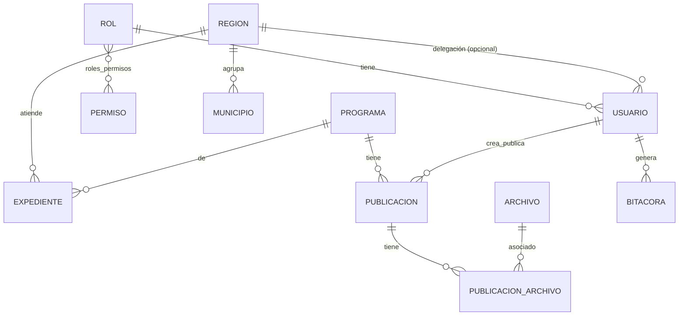

# Base de datos (PostgreSQL 16)

Migraciones con Alembic (`backend/alembic/versions`). Se aplican solas al arrancar (`alembic upgrade head`).



- **Región = Delegación Regional Forestal** (9 regiones, I a IX). Domicilio, teléfono y horario están vacíos: *por confirmar*.
- **Municipios:** los proporcionados por el equipo; la lista no es exhaustiva.
- **Usuario:** nombre, apellido paterno y apellido materno opcional.
- **Publicación:** programa, título, vigencia (inicio/fin) y `publicada_en`. Puede tener varios archivos relacionados.
- **publicacion_archivos:** relación entre publicación y archivo con `tipo`, `etiqueta` y `orden`.
- **Bitácora:** acción, recurso, resultado (`exitoso`/`fallido`/`denegado`), detalle y usuario.

Para ver los datos: pgAdmin en <http://localhost:5050>.

Nueva migración tras cambiar un modelo:
```bash
docker compose exec backend alembic revision --autogenerate -m "descripcion"
docker compose exec backend alembic upgrade head
```
## Sprint 2

Las entidades nuevas son `solicitudes`, `requisitos`, `documentos_solicitud`, `recepciones`,
`folios` y `acuses`. `programas.solicitud_en_linea` controla los programas disponibles para
el asistente. Los archivos siguen centralizados en `archivos`; un acuse es un archivo inmutable
relacionado con una solicitud.
