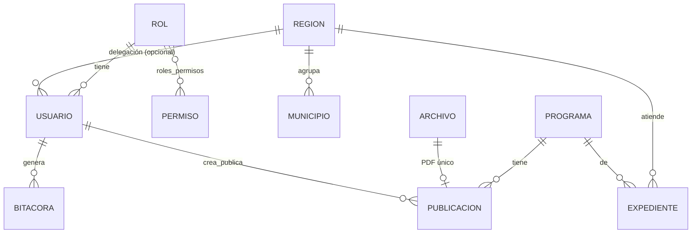

# Base de datos (PostgreSQL 16)

Migraciones con Alembic (`backend/alembic/versions`). Se aplican solas al arrancar (`alembic upgrade head`).



- **Región = Delegación Regional Forestal** (9 regiones, I a IX). Domicilio, teléfono y horario están vacíos: *por confirmar*.
- **Municipios:** los proporcionados por el equipo; la lista no es exhaustiva.
- **Publicación:** programa, título, vigencia (inicio/fin), un PDF y `publicada_en`. El **estado no se guarda**, se calcula: `borrador` (sin `publicada_en`), `programada`, `vigente`, `historica`.
- **Bitácora:** acción, recurso, resultado (`exitoso`/`fallido`/`denegado`), detalle y usuario.

Para ver los datos: pgAdmin en <http://localhost:5050>.

Nueva migración tras cambiar un modelo:
```bash
docker compose exec backend alembic revision --autogenerate -m "descripcion"
docker compose exec backend alembic upgrade head
```
